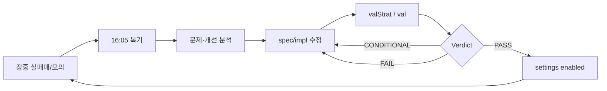

# 알고리즘 개선 사이클 (복기 → 수정 → 검증 → 반영)

운영 알고리즘(MTS01·MSE01 등)의 **수익률·수익금**을 높이기 위한 일일 루프입니다.  
실주문 없이 검증만 반복하고, 게이트 통과 시에만 실매매 설정을 켭니다.

## 1. 장마감 복기 (매 거래일 16:05)

| 항목 | 내용 |
|------|------|
| 스케줄 | `utils/algDayReviewScheduler.py` — 16:05~16:45, 1일 1회 |
| 대상 | `settings.deskAlgTabs` 운영 알고리즘 전체 |
| 저장 | `config/data/algDayReview/{tradeDt}_{algCd}.json` |
| 텔레gram | `pushKind=dayReview` (운영 설정에서 on/off) |
| 수동 | `python -c "from utils.algDayReviewScheduler import runAlgDayReviewJob; print(runAlgDayReviewJob(force=True))"` |

### 승패 기준 (전 알고리즘 공통)

**보유수량을 전량 청산했을 때의 최종 손익**으로만 판정합니다.

| 최종 손익 | 기록 |
|------|------|
| `> 0` | 승 |
| `< 0` | 패 |
| `= 0` | 본전 — 승·패 어디에도 넣지 않음 (승률 분모 제외) |

- 분할익절을 했는지(`HALF_YN`)는 **보지 않습니다.** 절반을 익절했어도 잔량에서 더 크게 잃으면 그 라운드는 **패**입니다.
- 부분청산만 하고 잔량을 남긴 날은 **아직 판정하지 않고**, 전량청산이 끝나는 날의 승패로 잡힙니다.
- 근거 데이터: `AI_STRAT_LIVE_TRADE` 1행 = 전량청산 1라운드, `PNL_WON` = 분할분까지 합산한 최종 손익.
- 판정 규칙 원본: `utils/stratLiveTradeStore.py::classifyRoundWl` — 당일·월·누적·매매일지·투자달력·백테스트가 모두 이 기준을 씁니다.
- 백테스트도 동일: 분할매수(`ADD`)·분할익절(`SELL_HALF`)을 수량가중으로 합산한 라운드 손익으로 승패를 냅니다 (`backtest/engine.py::buildTradeRounds`).
- **당일 수익금·수익률**은 계좌 당일손익과 맞추기 위해 그대로 **당일 매도분 실현손익**입니다. 승패만 라운드 기준입니다.

복기 리포트 포함 항목:

- **승률·당일 실현손익·매수/스킵/청산 건수**
- **1차 익절 통계(MFE)** — 최근 **10거래일 매수** 중 **1차 절반 전 -2% 손절** 건의 손절 전 고점 평균. 거래일 16:05에 MTS01 실매매 `halfTpPct` 반영 (settings 오버레이, spec 파일은 유지)
- **문제점** — 전패, 스킵 과다, 복수전략 차단, 1차 익절 미도달 등
- **유지** — 수익 청산·당일 플러스·종목별 고점 등
- **개선·검증** — spec/impl 수정 후 `valStrat` 또는 텔레그램 `val` 안내

조회: 웹 **매매일지** (`tradeJournal`) — 일자 선택 후 알고리즘 복기 카드·청산 고점%·문제/개선. 장마감 16:05 저장, 이후 매일 같은 화면에서 조회.

## 2. 분석·수정 (사람 + AI)

1. 복기 JSON 또는 텔레그램 요약 확인
2. 원인 가설 → **명세·파라미터·impl** 중 어디를 바꿀지 결정
3. 변경 파일 (역할 분리):

| 변경 | 경로 |
|------|------|
| 전략 설명 | `strategies/docs/{stratId}.md` |
| 파라미터·게이트 | `strategies/specs/{stratId}.json` |
| 신호 로직 | `strategies/impl/*.py` |
| 실매매 금액·on/off | `config/data/settings.json` (`maTouchLive`, `stratLive`) |

**주의:** TR/필드명은 `tr_docs/{apiId}.json` 명세 우선. 추측 구현 금지.

## 3. 검증만 실행 (실주문 없음)

### CLI (권장)

```bash
# 정적만 (spec/docs/impl 연계)
python examples/valStrat.py static maTouchScale_v1

# 관심종목 USE_BT=Y 일괄 BT
python examples/valStrat.py maTouchScale_v1 watch 20260101 20260331 1000

# MTS01 운영과 동일 16시 유니버스 → 다음날 BT
python examples/valStrat.py maTouchScale_v1 rank16h 20260814 20260818 1000
```

결과 저장: `config/data/stratValRun/{stratId}_{runTs}.json`

### 텔레그램

```
val static maTouchScale_v1
val 1 watch 20260101 20260331 1000
val list
```

### 판정

| Verdict | 의미 | 다음 단계 |
|---------|------|-----------|
| **PASS** | 게이트 통과 | 모의 실매매 유지·관찰, 충분하면 live 후보 |
| **CONDITIONAL** | 표본 부족 등 | 기간·유니버스 확대 후 재검증 |
| **FAIL** | MDD·수익 등 미달 | 파라미터·진입/청산 로직 재수정 |

게이트 임계: `utils/stratValidate.py` (`GATE_MIN_OK_STKS` 등)

## 4. 실매매 반영 (PASS·CONDITIONAL 후)

검증만으로는 주문이 나가지 않습니다. 아래 설정으로 **켜기**만 하면 됩니다.

### MTS01 (이평터치)

`config/data/settings.json`:

```json
"maTouchLive": {
  "enabled": true,
  "paperOnly": true
}
```

금액은 `stratLive.MTS01.buyAmtWon` 등.

### MSE01 (이평지지)

```json
"stratLive": {
  "MSE01": {
    "enabled": true,
    "buyAmtWon": 1000000
  }
}
```

`main.py` 재기동 또는 이미 떠 있는 프로세스의 `watchRtMonitor`가 설정을 읽습니다.

### spec status

- 수정 직후: `strategies/specs/*.json` → `"status": "test"`
- 모의에서 N일 관찰 후: `"status": "live"` (수동)

## 5. 사이클 다이어그램



## 6. 관련 API·UI

| API | 설명 |
|-----|------|
| `GET /api/algReview` | 당일 이벤트·청산 (원시) |
| `GET /api/algPnl` | 알고리즘별 손익 스냅 |
| `GET /api/algDayReview?algCd=MTS01&tradeDt=YYYYMMDD` | 저장된 복기 JSON (MFE·개선점 포함). 매매일지에서 조회 |
| `GET /api/tradeJournal?exitDt=YYYYMMDD` | 일자별 정산 + 당일 복기 요약(insights/halfTp) |

매매창 **계좌 탭** — 알고리즘별 당일/월/누적 PnL (`AI_ALG_PNL_DAY`)

웹 **매매일지** — 16:05 이후 당일 복기 전문. 구버전 JSON(halfTp 없음)은 조회 시 재생성.

## 7. 운영 on/off

`config/data/settings.json` → `batchSched.algDayReview`  
텔레그램 푸시 → `telegramPush.dayReview`

배치 목록 UI/명령에서 **알고리즘 당일 복기** 항목으로 확인 가능 (`utils/batchSchedRegistry.py`).
